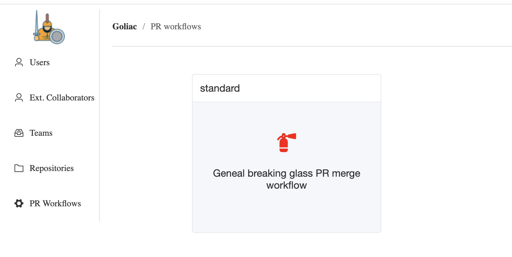
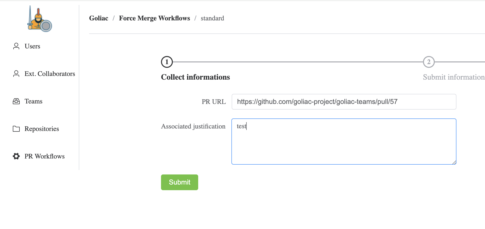
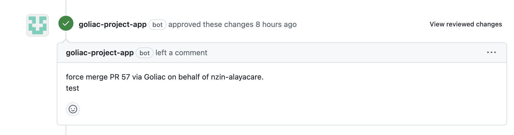

# Breaking Glass workflow

If you enable the Breaking Glass workflow, you will be able to force merge PRs in specific repositories and for specific teams. This is useful when you need to merge a PR in an emergency situation.

## First way: use the wizard





You have the possibliity to enable a Breaking Glass workflow that allows to force merge PRs in specific repositories and for specific teams. This is useful when you need to merge a PR in an emergency situation.




See [Workflows](resource_workflow) to see how to enable it

## Second way: use PR comments

You can also use PR comments to force merge a PR.

```
/forcemerge:<workflow_name>: <explanation>
```

Example:

```
/forcemerge:standard: need to merge this PR out of regular office hours to fix the production issue
```

This will trigger the `standard` workflow to merge the PR.

## Squash merge

By default, the PR will be merged with the `commit` merge type.


If you want to squash merge the PR, you can add the `/squash` string in the explanation.

Example:

```
/forcemerge:standard: need to merge this PR out of regular office hours to fix the production issue /squash
```

This will trigger the `standard` workflow to merge the PR with the `squash` merge type.

## Stacked PRs

GitHub only merges [stacked pull requests](https://docs.github.com/en/rest/pulls/pulls#merge-a-pull-request-asynchronously) through its asynchronous merge API. For a PR that is part of a stack, you can add an optional merge mode between the workflow name and the explanation:

```
/forcemerge:<workflow_name>: <explanation>
/forcemerge:<workflow_name>:direct: <explanation>
/forcemerge:<workflow_name>:stack: <explanation>
```

Only the exact words `direct` and `stack` (case-insensitive) are merge modes. Anything else stays part of the explanation, so `/forcemerge:standard: fix: prod is down` still has the explanation `fix: prod is down`.

Take the stack `1 > 2 > 3 > 4 > main`: PR 1 is the top (based on PR 2's branch) and PR 4 is the bottom (based on `main`).

- **Default, or `direct`**: merge only this PR into its base branch, then restack.
  - `/forcemerge:standard: <explanation>` on PR 3 merges PR 3 into PR 4's branch with a merge commit. Then every open PR based on PR 3's branch (PR 2) is retargeted onto PR 4's branch. The stack becomes `1 > 2 > 4 > main`.
  - On the bottom PR (PR 4), the PR is merged alone into `main` through the asynchronous merge API, and PR 3 is retargeted onto `main`.
  - On the top PR (PR 1), the PR is merged into PR 2's branch and there is nothing to retarget.
  - `/squash` is not available when merging into a parent branch: a merge commit is used, and the approval comment says so.
  - GitHub usually marks the PR as merged once its commits are in its base branch. If it does not, Goliac closes the PR with a comment saying where it was merged.
  - The PR's head branch is not deleted.
- **`stack`**: merge the whole stack into the stack base branch.
  - `/forcemerge:standard:stack: <explanation>` on any PR of the stack approves every PR from 1 to 4. It then merges the top PR (PR 1) through the asynchronous merge API, which merges PR 1 to PR 4 into `main`.
  - If a PR of the stack is missing or not open, nothing is approved or merged.

On a PR that is not part of a stack, `direct` and `stack` are ignored (the approval comment says so) and the PR is merged as usual.

The asynchronous merge:
- pins the PR head that Goliac approved (a push in between cancels the merge);
- never uses a merge queue;
- bypasses the rules Goliac is allowed to bypass.

Goliac waits up to 2 minutes for the result. A timeout, a refusal (e.g. conflicts) or a PR that is not ready to merge (closed, draft) is reported as an error comment.
